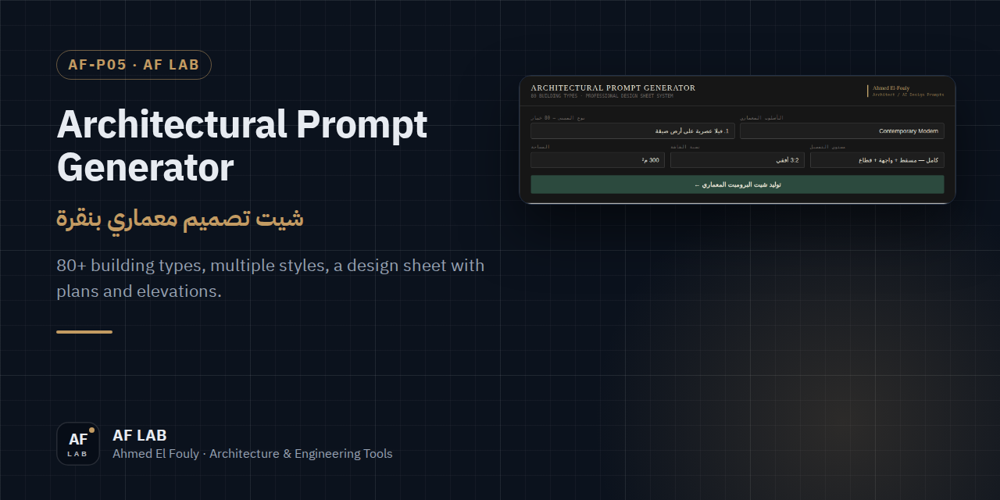
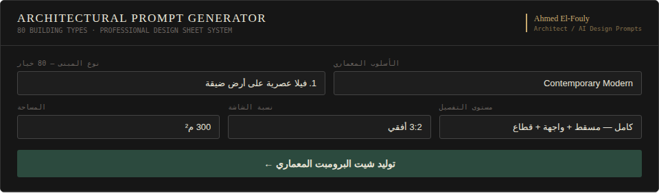

<p align="center">
  
</p>

<h1 align="center">Architectural Prompt Generator</h1>

<p align="center">
  <b>أكتر من 80 نوع مبنى وطُرز متعددة، ومخرَج لوحة تصميم فيها مساقط وواجهات بأبعاد</b><br>
  80+ building types, multiple styles, and a design-sheet output with plans and elevations.
</p>

<p align="center">
  <a href="https://af-lab.archprompt.workers.dev"></a>
  
  
  
</p>

<p align="center">
  
  <a href="https://af-lab.archprompt.workers.dev">AF LAB</a> &nbsp;·&nbsp;
  <a href="https://wa.me/201284537045">WhatsApp</a>
</p>

---

## نظرة سريعة · Overview

<div dir="rtl">

أداة لتوليد برومبتات معمارية احترافية للذكاء الاصطناعي (Midjourney وأدوات مشابهة)، بمخرَج جاهز على شكل **لوحة تصميم معمارية** فيها مساقط وواجهات بأبعاد. مصممة للمعماريين والمصممين عشان يوصلوا لنتيجة دقيقة بسرعة.

</div>

Generates professional architectural prompts for AI image tools, with a design-sheet output: floor plans, facade elevations, dimensions and a structured prompt.

<p align="center">
  
</p>

## المزايا · Features

<div dir="rtl">

- 🧩 **أكتر من 80 نوع مبنى:** فيلا عصرية، بيت ريفي، Tiny House، شقق سكنية، منازل ساحلية، مشاريع اقتصادية وغيرها.
- 🎨 **طُرز معمارية:** Contemporary Modern، Minimalist، Bioclimatic، Industrial، Vernacular Arabic، Neoclassical، Brutalist، Parametric.
- 📏 **معاملات قابلة للتخصيص:** المساحة (60 م² إلى 2000 م²)، ونسبة الشاشة (3:2 أفقي، 16:9 سينمائي، 2:3 رأسي، 1:1 مربع)، ومستوى التفصيل (مسقط وواجهة، أو كامل بقطاع، أو Concept وRender).
- 🧠 **توليد ذكي للبرومبت:** وصف المشروع، وتوزيع الفراغات، وتفاصيل الواجهة، وتعليمات CAD، وإعدادات Midjourney.

</div>

**مثال · Example**

```text
Architectural design sheet modern narrow-plot villa, 300sqm, 8x20m rectangular footprint, two floors.
Floor plan: entrance hall, open living-dining, kitchen with service door, 3 bedrooms, 2 bathrooms, staircase.
Facade elevation: contemporary modern – floor-to-ceiling glass panels, cantilevered upper floor, clean white and dark grey cladding.
Dimensions labeled, north arrow, scale bar. Side elevation + roof plan.
Professional CAD linework, black on white --ar 3:2 --style raw --v 6
```

## الاستخدام · How to use

<div dir="rtl">

1. اختار نوع المبنى والأسلوب المعماري.
2. أدخل المساحة واختار نسبة الصورة ومستوى التفصيل.
3. اضغط **توليد شيت البرومبت المعماري**.
4. انسخ البرومبت واستخدمه في Midjourney.

</div>

## الاستخدامات · Use cases

المعماريين وطلبة العمارة، ومصممي فن الذكاء الاصطناعي، والـ Freelancers، ومكاتب التصميم. · Architects and students, AI-art designers, freelancers and design offices.

## خطة التطوير · Roadmap

- [ ] 3D massing prompts
- [ ] دعم Stable Diffusion · Stable Diffusion support
- [ ] تصدير لوحة التصميم PDF · PDF export of the design sheet
- [ ] إعداد غرف مخصص · custom room configuration
- [ ] تعدد اللغات · multi-language

## تشغيل محلي · Run locally

```bash
git clone https://github.com/engfouly1987/ARCHITECTURAL-PROMPT-GENERATOR.git
cd ARCHITECTURAL-PROMPT-GENERATOR
# افتح index.html في المتصفح · open index.html in your browser
```

مفيش تثبيت ولا خادم. ملف واحد يشتغل مباشرة. · No install, no server: it runs straight from the file.

## المساهمة · Contributing

<div dir="rtl">

أي اقتراح أو تحسين مرحّب بيه: افتح Issue أو اعمل Fork و Pull Request.

</div>

## الترخيص · License

MIT

## التواصل · Contact

<div dir="rtl">

للاستفسار أو طلب أداة أو تعديل، أسرع طريقة **واتساب**. وباقي القنوات تحت.

</div>

| | |
|---|---|
| 💬 WhatsApp | [+20 128 453 7045](https://wa.me/201284537045) |
| ✉️ Email | [ahmedfouly08@gmail.com](mailto:ahmedfouly08@gmail.com) |
| 🌐 AF LAB | [af-lab.archprompt.workers.dev](https://af-lab.archprompt.workers.dev) |
| Facebook | [ahmed.fooly](https://www.facebook.com/ahmed.fooly) |
| Instagram | [@ah.elfouly](https://www.instagram.com/ah.elfouly/) |
| GitHub | [engfouly1987](https://github.com/engfouly1987) |

---

<p align="center">
  <sub>جزء من <a href="https://af-lab.archprompt.workers.dev"><b>AF LAB</b></a> — أدوات ومؤلفات وتطبيقات ويب للمهندسين والمعماريين.<br>
  Part of <a href="https://af-lab.archprompt.workers.dev"><b>AF LAB</b></a> — tools, books and web apps for engineers and architects.</sub>
</p>
